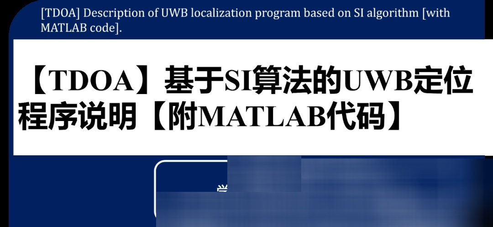
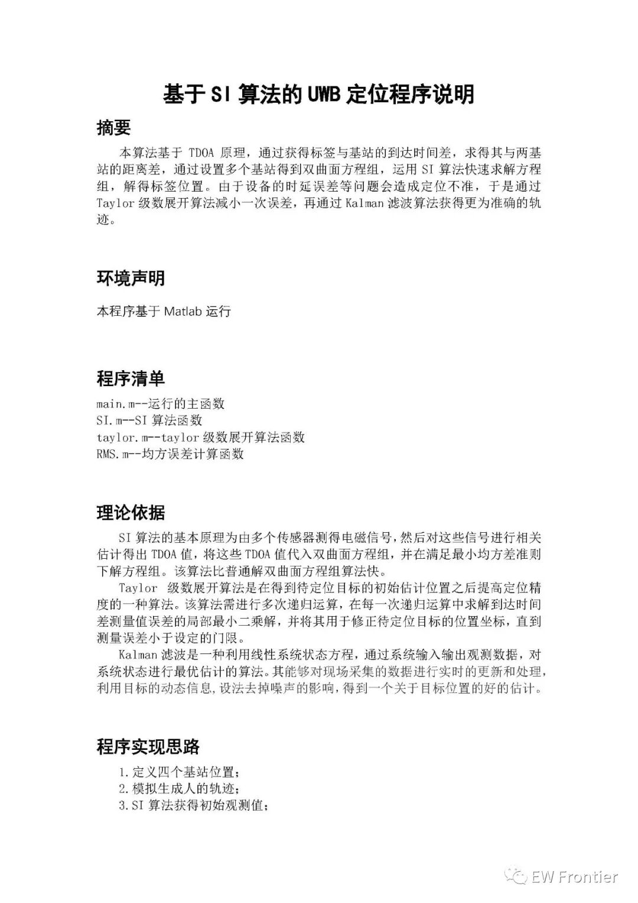
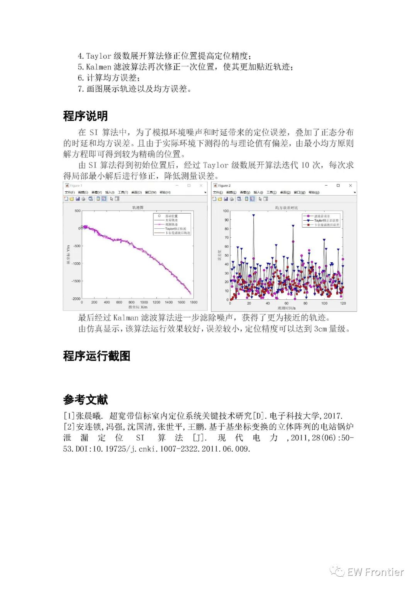

# [TDOA] UWB Positioning Program Based on SI Algorithm with MATLAB Code

\t  
​  
More radar and communication MATLAB codes
clc;\nclear;  \nT=1;% Scan cycle\nN=120/T;% Number of samples\nCR=15;% Base station location\nBS=zeros(2,7);\nBS(:,1)=[0,0];\nBS(:,2)=[0,3*CR];\nBS(:,3)=[3*CR,3*CR];\nBS(:,4)=[3*CR,0];\nX=zeros(4,N);%Target real position, speed\nX(:,1)=[30,2,40,2];% Target initial position (30,40) speed (2,2)\nZ=zeros(2,N);% Observation of the position by base station\na=exprnd(1,1,4);% The process noise of exponential distribution\nQ=diag(a);% Process noise\nb=exprnd(3,1,2);\nR=60*diag(b); % Observation noise index distribution\nA=[1,T,0,0;\n   0,1,0,0;\n   0,0,1,T;\n   0,0,0,1]; %State transition matrix\nG=[1,0,0,0;\n   0,0,1,0];\n%%%%%%%%%%%%%%%%%%%%%%%%%%%%%%%%%%%%%%%%%%%%%%%%%% \nfor t=2:N      \n    X(:,t)=A*X(:,t-1)+sqrtm(Q)*randn(4,1);% Target real trajectory\nend\nMX=X(1,:);\nMY=X(3,:);\nfor t=1:N\n    yuce=SI(MX(1,t),MY(1,t));\n    Z(:,t)=[yuce(1);yuce(2)]+sqrtm(R)*randn(2,1);% Observations of the target\nend\n​\n%Taylor correction\nfor t=1:N\n    track=Taylor(Z(1,t),Z(2,t));\n    TL(:,t)=[track(1);track(2)]+sqrtm(R)*randn(2,1);% Observations of the target\nend\n​\n% Kalman filtering\nXkf=zeros(4,N); % Optimal estimation after filtering\nXkf(:,1)=X(:,1);% Initialization\nP0=eye(4);% Error covariance matrix initialization\nfor i=2:N      \n    % Prediction Equation\n    Xn=A*Xkf(:,i-1);% State prediction\n    P1=A*P0*A'+Q;%Prediction error covariance\n    % Information equation\n    K=P1*G'/(G*P1*G'+R);% Kalman gain\n    % Estimated equation\n    Xkf(:,i)=Xn+K*(TL(:,i)-G*Xn);% Status Update\n    P0=(eye(4)-K*G)*P1;% Filtering error covariance update\nend\n% Error Analysis\nfor i=1:N      \n    Observation(i)=RMS(X(:,i),Z(:,i));% Error before filtering\n    TaylorFilter(i)=RMS(X(:,i),TL(:,i));%Taylor's corrected error\n    KalmanFilter(i)=RMS(X(:,i),Xkf(:,i));% Kalman Filtering Error\nend\n%%%%%%%%%%%%%%%%%%%%%%%%%%%%%%%%%%%%%%%%%%%%%%%%%% \n% Draw a picture\nfigure \nhold on;box on;  \nplot(BS(1,:),BS(2,:),'ko');% Base station\nplot(X(1,:),X(3,:),'-k');% Actual trajectory\nplot(Z(1,:),Z(2,:),'-mx');% Observation trajectory\nplot(TL(1,:),TL(2,:),'-b');%Taylor corrected trajectory\nplot(Xkf(1,:),Xkf(3,:),'-r');%Kalman filter trajectory\nlegend('Base station location','True trajectory','Observation trajectory','TaylorCorrect trajectory','Kalman filter trajectory') ;\nxlabel('Cross-axis X/m'); ylabel('Longitudinal axis Y/m'); \ntitle('Trajectory chart');\nfigure \nhold on;box on;  \nplot(Observation,'-ko','MarkerFace','m');\nplot(TaylorFilter,'-kv','MarkerFace','b');\nplot(KalmanFilter,'-ks','MarkerFace','r');\nlegend('Pre-filtering error','TaylorCorrected error','Kalman filtering error after');\nxlabel('Observation time/s'); ylabel('Error value'); \ntitle("Mean Squared Error Comparison");\n  

## Images

<!-- PAYMENT_BLOCK -->

## Get this dataset

- Payment link (Stripe): [Buy now](https://buy.stripe.com/3cs8yP7sY87d0vu9AB)
- Payment QR code: 

<!-- /PAYMENT_BLOCK -->
